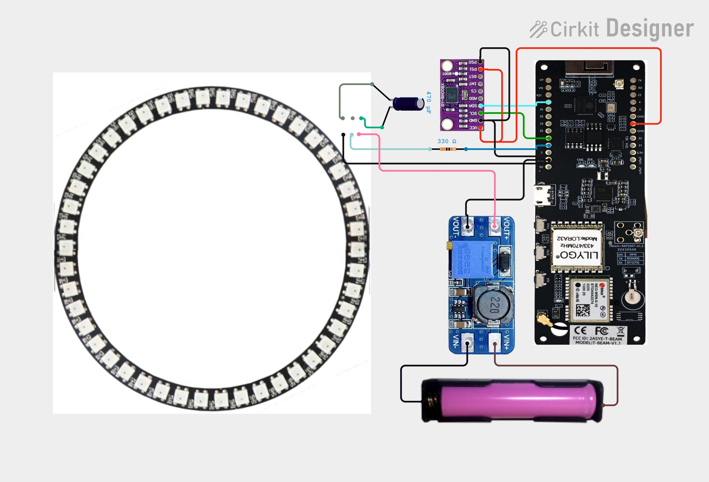
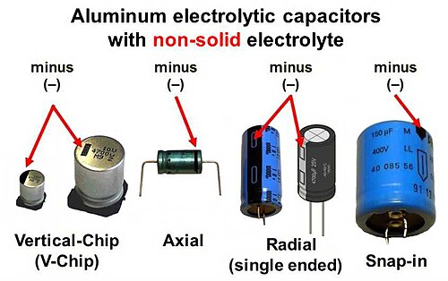

# bno08x-quaternion-arduino-esp32

Step-by-step PlatformIO/Arduino project to connect a **Bosch BNO085 (BNO08x)** IMU to an **T-Beam** and read orientation / motion data over **UART**.  
This repository documents my incremental approach: validate each building block first (currently:  exchange ESP32-CAM with T-Beam). The used environment is VS Code and Platform IO.

---

## Status

✅ Successful test run with ESP32-CAM
🚧 Work in progress: exchange the EPS32-CAM with T-Beam.
Next step: add the LED-ring 
---

## Hardware

- **T-Beam**
- **BNO085 / BNO08x IMU**
- **MT3608**
---

## Development Environment

- **VS Code**
- **PlatformIO**
- Arduino framework (ESP32)

---

## Images

---
# demo video link

---
## CAD circuit

[Cirkit Designer project](https://app.cirkitdesigner.com/project/0ad9613a-4fe2-4771-b38f-fe5e346340fd)

---

## Shopping cart

[Shopping cart](https://linktr.ee/UARTBNO085)

## Wiring / Circuit Documentation

This circuit integrates a LILYGO T-Beam Meshtastic LORA32 915MHz module, a BNO085 sensor, a NEOPIXEL WS2812 45 LED RING, an Electrolytic Capacitor, a Resistor, an 18650 battery in a holder, and an MT3608 boost converter. The circuit is designed to power and control the LED ring and sensor using the LILYGO module, with seperate power supply of the  NEOPIXEL WS2812 45 LED RING by the 18650 battery and regulated by the MT3608.

## **Component List**

> 1. **LILYGO T-Beam Meshtastic LORA32 915MHz**  
   * **Description**: A microcontroller module with LoRa capabilities.  
   * **Pins**: TX, RX, 23, 4, 0, GND, 3V3, SCL/22, SDA/21, 3.3V, LoRa2, 5V, 2, 13, 14, 25, 33, 32, 35, 15, RST, VN, VP  

> 2. **BNO085**  
   * **Description**: A 9-axis sensor providing orientation and motion data.  
   * **Pins**: VCC, GND, SCL/SCK/RX, SDA/MISO/TX, ADR/MOSI, CS, INT, RST, PS1, PS0  
   
   
   
> 3. **NEOPIXEL WS2812 45 LED RING**  
   * **Description**: A ring of 45 individually addressable RGB LEDs.  
   * **Pins**: GND, D1, 5V, D0  
> 4. **Electrolytic Capacitor**  
   * **Description**: A capacitor used for power smoothing.  
   * **Properties**: Capacitance: 0.00047 Farads  
   * **Pins**: \-, \+  

   

> 5. **Resistor**  
   * **Description**: A resistor used for current limiting.  
   * **Properties**: Resistance: 330 Ohms  
   * **Pins**: pin1, pin2  

> 6. **18650 in holder**  
   * **Description**: A rechargeable lithium-ion battery in a holder.  
   * **Pins**: GND, VCC  

> 7. **MT3608**  
   * **Description**: A DC-DC boost converter for voltage regulation.  
   * **Pins**: VIN+, VIN-, VOUT+, VOUT-

## **Wiring Details**

### **LILYGO T-Beam Meshtastic LORA32 915MHz**

> * **Pin 15** is connected to **BNO085 SDA/MISO/TX**.  
> * **Pin 14** is connected to **BNO085 SCL/SCK/RX**.  
> * **Pin 3V3** is connected to **BNO085 VCC** and **PS1**.  
> * **Pin GND** is connected to **BNO085 GND**, **PS0**, **MT3608 VOUT-**, and **NEOPIXEL WS2812 45 LED RING GND**.  
> * **Pin 13** is connected to **Resistor pin2**.

### **BNO085**

> * **SDA/MISO/TX** is connected to **LILYGO T-Beam Meshtastic LORA32 915MHz Pin 15**.  
> * **SCL/SCK/RX** is connected to **LILYGO T-Beam Meshtastic LORA32 915MHz Pin 14**.  
> * **VCC** and **PS1** are connected to **LILYGO T-Beam Meshtastic LORA32 915MHz Pin 3V3**.  
> * **GND** and **PS0** are connected to **LILYGO T-Beam Meshtastic LORA32 915MHz Pin GND**, **MT3608 VOUT-**, and **NEOPIXEL WS2812 45 LED RING GND**.

### **NEOPIXEL WS2812 45 LED RING**

> * **GND** is connected to **LILYGO T-Beam Meshtastic LORA32 915MHz Pin GND**, **BNO085 GND**, **PS0**, and **MT3608 VOUT-**.  
> * **D1** is connected to **Resistor pin1**.  
> * **5V** is connected to **Electrolytic Capacitor \+** and **MT3608 VOUT+**.  
> * **D0** is not connected.

### **Electrolytic Capacitor**

> * **\-** is connected to **NEOPIXEL WS2812 45 LED RING GND**.  
> * **\+** is connected to **NEOPIXEL WS2812 45 LED RING 5V**.

### **Resistor**

> * **pin1** is connected to **NEOPIXEL WS2812 45 LED RING D1**.  
> * **pin2** is connected to **LILYGO T-Beam Meshtastic LORA32 915MHz Pin 13**.

### **18650 in holder**

> * **GND** is connected to **MT3608 VIN-**.  
> * **VCC** is connected to **MT3608 VIN+**.

### **MT3608**

> * **VIN+** is connected to **18650 in holder VCC**.  
> * **VIN-** is connected to **18650 in holder GND**.  
> * **VOUT+** is connected to **NEOPIXEL WS2812 45 LED RING 5V**.  
> * **VOUT-** is connected to **LILYGO T-Beam Meshtastic LORA32 915MHz Pin GND**, **BNO085 GND**, **PS0**, and **NEOPIXEL WS2812 45 LED RING GND**.

## Serial monitor example print

Adafruit BNO08x Accelerometer test!
BNO08x Found!
Reading events
sensor was reset Yaw: 0.00
Yaw: -141.18
Yaw: -141.19
Yaw: -141.14
Yaw: -139.31
Yaw: -139.32
Yaw: -139.31
Yaw: -139.30
Yaw: -139.29

---

## License

This project is open-source under the MIT License. See [LICENSE](LICENSE) for more information.

---

## Acknowledgements

* Bosch / Hillcrest Labs – BNO085
* Wolles Elektronikkiste
[Wolles Elektronikkiste](https://wolles-elektronikkiste.de/en/bno08x-9-dof-imus)

