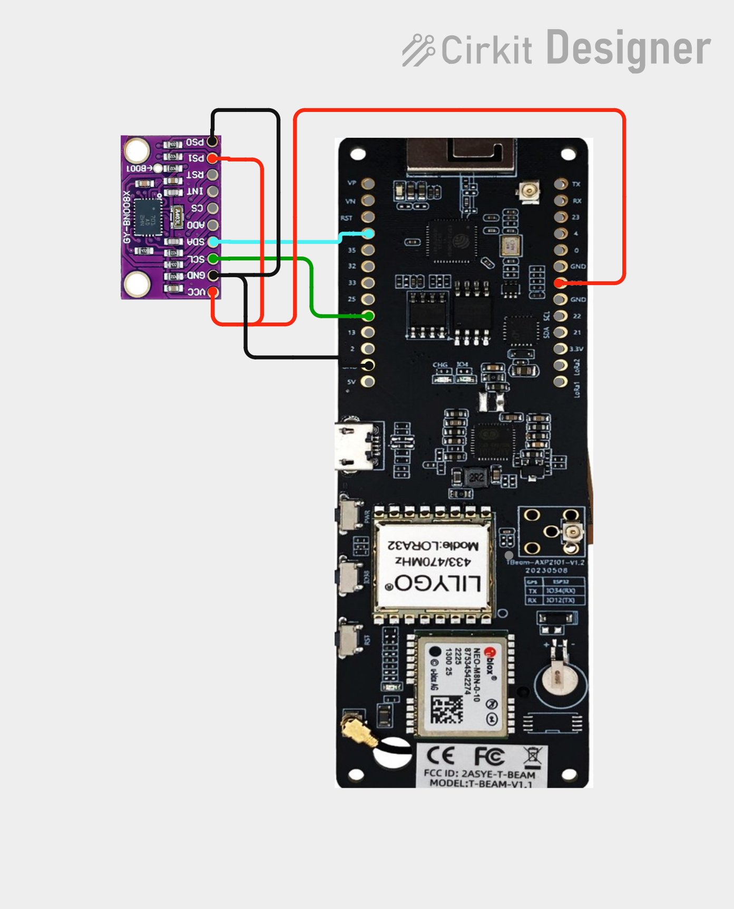
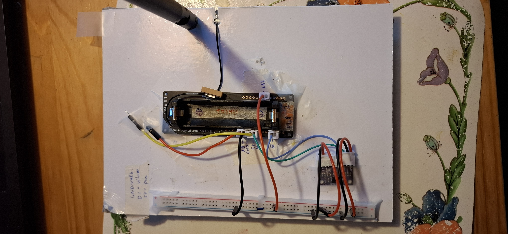
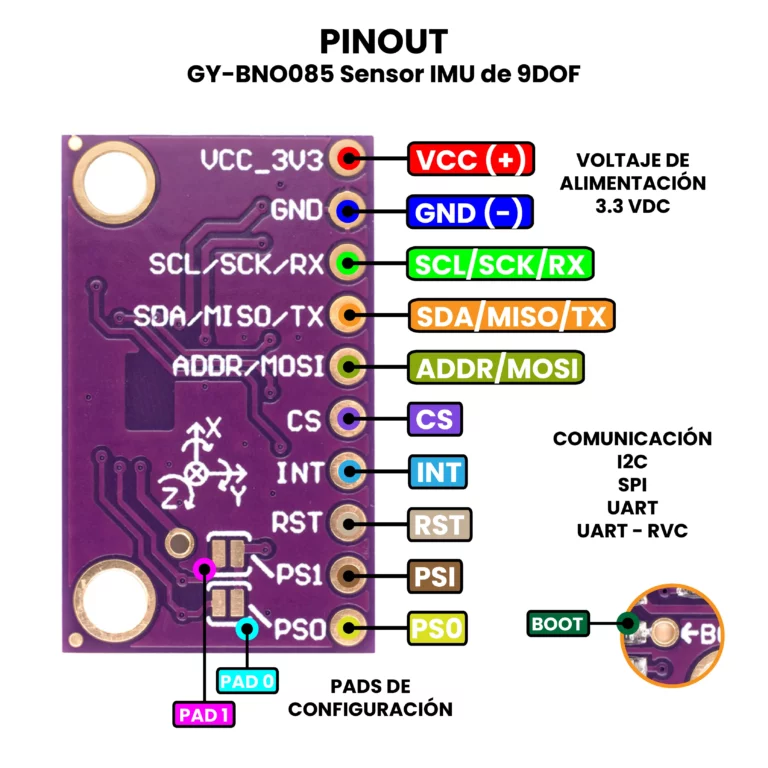

# bno08x-quaternion-arduino-esp32

Step-by-step PlatformIO/Arduino project to connect a **Bosch BNO085 (BNO08x)** IMU to an **T-Beam** and read orientation / motion data over **UART**.  
This repository documents my incremental approach: validate each building block first (currently:  exchange ESP32-CAM with T-Beam). The used environment is VS Code and Platform IO.

---

## Status

✅ Successful test run with ESP32-CAM
🚧 Work in progress: exchange the EPS32-CAM with T-Beam.
Next step: add the LED-ring 
---

## Hardware

- **T-Beam**
- **BNO085 / BNO08x IMU**
---

## Development Environment

- **VS Code**
- **PlatformIO**
- Arduino framework (ESP32)

---

## Images

---

---
## CAD circuit

[Cirkit Designer project](https://app.cirkitdesigner.com/project/7dc46603-23f3-4723-bd57-30f7109c99e6)

---

## Shopping cart

[Shopping cart](https://linktr.ee/UARTBNO085)

## Wiring / Circuit Documentation

This circuit integrates an T-Beam module  and a BNO085 IMU sensor. The T-Beam  serves as the main microcontroller, interfacing with the BNO085 sensor to read orientation data. 

## Component List

### **LILYGO T-Beam Meshtastic LORA32 915MHz**

> * **Component Name:** LILYGO T-Beam Meshtastic LORA32 915MHz  
> * **Description:** A microcontroller board with integrated LoRa communication capabilities.  
> * **Pins:** TX, RX, 23, 4, 0, GND, 3V3, SCL/22, SDA/21, 3.3V, LoRa2, 5V, 2, 13, 14, 25, 33, 32, 35, 15, RST, VN, VP

### **BNO085**

> * **Component Name:** BNO085  
> * **Description:** An advanced sensor module providing orientation and motion data.  
> * **Pins:** VCC, GND, SCL/SCK/RX, SDA/MISO/TX, ADR/MOSI, CS, INT, RST, PS1, PS0 

## **Wiring Details**

### **LILYGO T-Beam Meshtastic LORA32 915MHz**

> * **Pin 15** is connected to **BNO085 SDA/MISO/TX** for I2C data communication.  
> * **Pin 14** is connected to **BNO085 SCL/SCK/RX** for I2C clock communication.  
> * **Pin 3V3** is connected to **BNO085 VCC** and **PS1** to provide power.  
> * **Pin GND** is connected to **BNO085 GND** and **PS0** to complete the power circuit.

### **BNO085**

> * **SDA/MISO/TX** is connected to **LILYGO T-Beam Pin 15** for I2C data communication.  
> * **SCL/SCK/RX** is connected to **LILYGO T-Beam Pin 14** for I2C clock communication.  
> * **VCC** is connected to **LILYGO T-Beam Pin 3V3** to receive power.  
> * **GND** is connected to **LILYGO T-Beam Pin GND** to complete the power circuit.  
> * **PS1** is connected to **VCC** for power configuration.  
> * **PS0** is connected to **GND** for power configuration.

---

## Serial monitor example print

Adafruit BNO08x Accelerometer test!
BNO08x Found!
Reading events
sensor was reset Yaw: 0.00
Yaw: -141.18
Yaw: -141.19
Yaw: -141.14
Yaw: -139.31
Yaw: -139.32
Yaw: -139.31
Yaw: -139.30
Yaw: -139.29

---

## License

This project is open-source under the MIT License. See [LICENSE](LICENSE) for more information.

---

## Acknowledgements

* Bosch / Hillcrest Labs – BNO085
* Wolles Elektronikkiste
[Wolles Elektronikkiste](https://wolles-elektronikkiste.de/en/bno08x-9-dof-imus)

